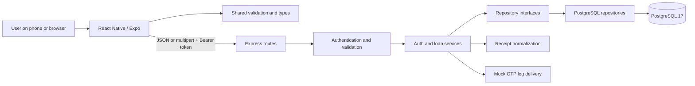
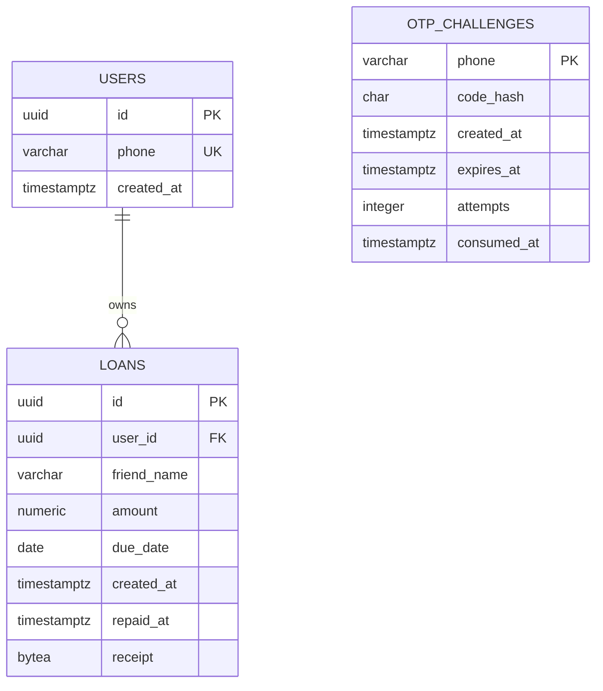

# MiniLedger architecture and function guide

This file explains what was built, what each application function does, and why the responsibilities are separated. Read it with [the API examples](docs/api.md) and [the implementation record](plan.md).

## 1. The system in one picture

The app is an npm workspace with three packages. `apps/mobile` owns the interface. `apps/api` owns HTTP, application behavior and persistence. `packages/contracts` owns shared validation and API shapes. Dependencies are passed into factory functions; there is no dependency-injection framework or unnecessary base-class hierarchy.

## 2. The main decisions

| Decision                    | Reason                                                                                                 | Tradeoff                                                                             |
| --------------------------- | ------------------------------------------------------------------------------------------------------ | ------------------------------------------------------------------------------------ |
| Expo / React Native         | One app for Android, iOS and browser review                                                            | The browser build is not proof of native device testing                              |
| Express 5 and TypeScript    | Small, familiar HTTP layer with async error handling                                                   | Contracts still need runtime validation                                              |
| `pg` and parameterized SQL  | Makes transactions, ownership predicates and money aggregation explicit in an interview                | SQL migrations and row mapping are maintained manually                               |
| PostgreSQL `NUMERIC(12,2)`  | Exact decimal storage and aggregation                                                                  | Clients send money as strings                                                        |
| UTC date-only due dates     | One documented overdue rule for all clients                                                            | Local midnight is not the cutoff                                                     |
| One `repaid_at` state field | Status cannot disagree with a separate boolean                                                         | Only full repayment is supported                                                     |
| Shared Zod contracts        | Validation rules are defined once                                                                      | Rebuild the shared package after editing it                                          |
| Receipt bytes in PostgreSQL | Photo and loan are committed together; no orphan files                                                 | Large collections should move to private object storage                              |
| HMAC-hashed OTPs            | Low-entropy codes are not stored in plaintext; keyed hashes resist offline guessing without the secret | Mock log delivery intentionally exposes the code to log readers                      |
| Repository interfaces       | Services depend on behavior, not database details                                                      | Interfaces must be kept small and tied to real use cases                             |
| Offset pagination           | Easy to understand for a small ledger                                                                  | New inserts can shift pages; refresh and client deduplication handle the common case |
| No automatic POST retries   | Avoids silently creating duplicate loans                                                               | After a timeout the user must refresh before retrying                                |

All financial calculations happen in PostgreSQL. The app converts decimal strings to JavaScript numbers only for display using `Intl.NumberFormat`; totals above JavaScript's exact integer range would need a decimal-aware formatter. The SQL summary returns decimal strings with two fractional digits and has a larger aggregate precision than an individual entry.

## 3. Data model and invariants

- A user has a unique international-format phone number. Users are created only after successful OTP verification.
- An OTP challenge can exist before a user exists. One row per phone holds its latest challenge. Resends replace that row after the cooldown.
- Every loan has one owner. Every list, summary, repayment and receipt query includes the authenticated `user_id`; ownership never comes from the request body.
- Database constraints enforce positive amounts, nonblank names, date bounds and receipt size. Application validation provides clearer error messages before those constraints are reached.
- `repaid_at IS NULL` means outstanding. `repaid_at IS NOT NULL` means repaid. An overdue entry must be outstanding and have `due_date < todayUtc`.
- An index on `(user_id, created_at DESC, id DESC)` supports account-scoped lists. A partial `(user_id, due_date)` index covers unpaid loans. Summaries currently aggregate all rows for an account, which is appropriate at this scale.
- `schema_migrations` tracks each applied SQL filename and checksum. Never edit an applied migration; add a new numbered file instead.

## 4. Request flows

### OTP request and verification

1. The route validates the phone/code with the shared schema.
2. `requestOtp` generates a cryptographically random six-digit code and a phone-bound HMAC hash.
3. `saveChallenge` locks the phone with a PostgreSQL transaction advisory lock. This also serializes two first-ever requests where there is no row to lock yet.
4. It checks the persistent 60-second cooldown, then inserts or replaces the challenge. Only after saving does the service print the code through `OtpDelivery`.
5. `consumeChallenge` takes the same lock, checks consumption, expiry and attempts, then compares hashes in constant time.
6. A wrong attempt increments the counter and commits. It returns a result instead of throwing inside the transaction, because rolling back would otherwise undo the attempt count.
7. A correct attempt consumes the code and creates/reuses the user in one transaction. The service then signs a one-day HS256 JWT containing a subject UUID, issuer and audience.

The injected clock makes expiry and due-date tests deterministic. JWT signing uses the library's actual system clock; integration tests also create an explicitly expired JWT to test token expiry.

### Create a loan with a receipt

The mobile client appends an `expo-file-system` `File` referencing the picked image to FormData. Expo 57 installs its own global fetch, whose multipart encoder reads file bytes and rejects the old React Native `{ uri, name, type }` descriptor. Web continues to append the browser File/Blob. The client leaves Content-Type unset for multipart requests so fetch supplies the matching boundary; requests without a receipt remain JSON. The dependency is declared directly with the SDK-compatible version.

Authentication runs before multipart parsing. Multer applies file, field and part limits. The route validates ordinary fields. The service normalizes the optional image before inserting one row containing the entry and photo. A rejected image therefore creates no entry. Sharp decodes the image, checks its actual format, caps input pixels, applies rotation, resizes inside 1600×1600 and writes JPEG without original EXIF metadata. Database byte limits provide a second guard.

### Mark repaid and refresh totals

The repository uses `SET repaid_at = COALESCE(repaid_at, $timestamp)` with the owner and entry ID in the predicate. PostgreSQL serializes concurrent updates to the same row. The first repayment time survives later retries. Summary queries aggregate stored loans; there is no mutable cached total that could be incremented twice. The app refreshes both the list and summary after success.

The list and summary are separate requests, so a concurrent change from another device can briefly make them represent different snapshots. A refresh reconciles them; a larger system could return a single transactionally consistent dashboard response.

## 5. SOLID, DRY and modularity in this code

| Principle             | Concrete application                                                                                                                                                         |
| --------------------- | ---------------------------------------------------------------------------------------------------------------------------------------------------------------------------- |
| Single responsibility | Routes translate HTTP; services coordinate behavior; repositories execute SQL; components render; hooks manage async UI state                                                |
| Open/closed           | Replace mock `OtpDelivery.send` with an SMS adapter or supply a different repository without changing route logic                                                            |
| Liskov substitution   | Repository implementations must preserve their interface contracts, including missing-resource behavior and atomic OTP consumption; no inheritance is forced into the design |
| Interface segregation | Authentication and loan repositories expose only their own operations; receipt processing and delivery use small separate capabilities                                       |
| Dependency inversion  | Services accept repository interfaces, a clock and delivery/processing functions; `server.ts` connects concrete implementations                                              |
| DRY                   | Shared schemas, one loan projection/row mapper, one transaction helper, one error boundary, one HTTP client and reusable form/button components                              |
| Modularity            | Each feature has routes, services and repositories together; platform-specific storage and upload differences live at the client boundary                                    |

These principles guide where changes belong. They do not mean creating an abstraction for every line of code. There is no generic CRUD repository, inheritance tree, event bus or external state manager because the assignment does not require them.

## 6. Backend function reference

File paths below are relative to `apps/api/src`.

| File / function                                | What it does                                                                                                     | Why it lives here                                                         |
| ---------------------------------------------- | ---------------------------------------------------------------------------------------------------------------- | ------------------------------------------------------------------------- |
| `config.ts` → `readConfig`                     | Loads/validates environment values, checks secrets, parses CORS origins                                          | Fails early with field names rather than leaking secret values            |
| `db/pool.ts` → `createPool`                    | Creates a bounded PG connection pool with connection/statement timeouts                                          | One place for database resource settings                                  |
| `db/pool.ts` → `inTransaction`                 | Begins, commits or rolls back work and always releases the client                                                | Prevents repeated transaction boilerplate and leaked connections          |
| `db/migrate.ts` → `migrate`                    | Locks migrations, reads sorted SQL, checks hashes, applies new files atomically                                  | Safe repeatable startup with protection against changed migration history |
| `db/migrate.ts` → CLI entry block              | Reads config, runs migration, closes the pool, sets failure exit code                                            | The same migrator works from npm, Docker and tests                        |
| `lib/errors.ts` → `AppError` constructor       | Carries expected HTTP status, stable code and user-facing message                                                | Separates known failures from programming/server errors                   |
| `lib/time.ts` → `systemClock`                  | Supplies the current `Date`                                                                                      | Injectable production clock                                               |
| `lib/time.ts` → `utcToday`                     | Converts a clock result to `YYYY-MM-DD` in UTC                                                                   | Shared cutoff logic for list, creation, repayment and totals              |
| `middleware/authenticate.ts` → `authenticate`  | Builds middleware that verifies Bearer JWT signature, algorithm, issuer, audience, expiry and UUID subject       | Establishes trusted identity before protected handlers                    |
| `middleware/error-handler.ts` → `errorHandler` | Maps validation, uploads, body parsing and application errors; logs unexpected failures                          | One stable error contract; no stack traces sent to clients                |
| `app.ts` → `createApp`                         | Composes security headers, CORS, request IDs/logging, limits, health routes, auth, loan routes and error handler | HTTP composition is testable without opening a port                       |
| `app.ts` → health callback                     | Returns process liveness                                                                                         | Liveness does not depend on PostgreSQL                                    |
| `app.ts` → readiness callback                  | Calls the injected database probe and returns 200 or 503                                                         | Compose waits for a usable API                                            |
| `server.ts` → composition block                | Creates logger, pool, repositories, services, app and listening server                                           | The only production wiring location                                       |
| `server.ts` → delivery `send`                  | Writes the phone and mock OTP to the API log                                                                     | Assignment's replaceable mock SMS implementation                          |
| `server.ts` → database probe                   | Executes `SELECT 1`                                                                                              | Readiness tests the real connection pool                                  |
| `server.ts` → `shutdown`                       | Stops accepting requests, closes database connections and enforces a shutdown deadline                           | Container SIGTERM/SIGINT can exit cleanly                                 |
| `modules/auth/auth.routes.ts` → `authRouter`   | Builds request/verify routes with an auth-specific IP limiter                                                    | Keeps transport concerns out of the auth service                          |
| Auth request route callback                    | Parses phone, calls `requestOtp`, returns metadata                                                               | Never returns the OTP                                                     |
| Auth verification route callback               | Parses phone and code, calls `verifyOtp`, returns the session                                                    | One entry point for session issuance                                      |
| `auth.service.ts` → `createAuthService`        | Creates auth behavior from repository, secrets, clock and delivery                                               | Dependency inversion without a framework                                  |
| Auth service → local `hash`                    | Produces HMAC-SHA256 over `phone:otp`                                                                            | Binds a code to its phone and secret                                      |
| Auth service → `requestOtp`                    | Generates a code, saves its hash/expiry, checks cooldown result and dispatches it                                | Coordinates the OTP request use case                                      |
| Auth service → `verifyOtp`                     | Supplies constant-time comparison, maps verification outcomes, signs JWT                                         | Coordinates the verification use case                                     |
| `auth.repository.ts` → `createAuthRepository`  | Returns PostgreSQL-backed auth operations                                                                        | Encapsulates persistence                                                  |
| Auth repository → `saveChallenge`              | Locks phone, checks cooldown and atomically upserts the latest hash                                              | Concurrent requests cannot bypass resend limits                           |
| Auth repository → `consumeChallenge`           | Atomically checks/consumes code or persists failed attempts, then upserts user                                   | Prevents replay and lost attempt increments                               |
| `modules/loans/loan.routes.ts` → `loanRouter`  | Builds protected list/create/summary/repay/receipt handlers and limited multipart parser                         | Keeps parameter/body parsing at the HTTP boundary                         |
| Loan route callbacks                           | Parse pagination, creation input or UUID; invoke matching service method                                         | Use 201 only for creation and 200 for reads/repayment                     |
| `loan.service.ts` → `createLoanService`        | Creates loan use cases with repository, clock and receipt processor                                              | Services remain independent of SQL and Sharp                              |
| Loan service → `list`                          | Requests one extra row and computes `nextOffset`                                                                 | Pagination metadata without a separate count query                        |
| Loan service → `create`                        | Processes optional receipt and inserts the validated entry                                                       | Invalid images fail before persistence                                    |
| Loan service → `repay`                         | Supplies UTC date/time and maps a missing row to 404                                                             | Uniform ownership-safe missing-entry behavior                             |
| Loan service → `summary`                       | Requests totals with today's UTC date                                                                            | Client never computes financial totals                                    |
| Loan service → `receipt`                       | Fetches owner-scoped bytes, returns a JPEG data URI or 404                                                       | Private photos work on web and native without public URLs                 |
| `loan.repository.ts` → `toLoan`                | Maps PostgreSQL `Date` timestamps into ISO strings                                                               | Repository output actually matches the shared contract                    |
| `loan.repository.ts` → `createLoanRepository`  | Returns SQL-backed loan operations                                                                               | Contains every loan persistence query                                     |
| Loan repository → `list`                       | Selects owner-scoped rows in stable newest-first order with limit/offset                                         | Does not select receipt blobs into the list                               |
| Loan repository → `create`                     | Inserts fields and optional photo in one statement and returns the mapped loan                                   | Atomic entry/photo creation                                               |
| Loan repository → `repay`                      | Updates only the owner's row using `COALESCE` and returns it                                                     | Idempotent and safe for concurrent repayment                              |
| Loan repository → `summary`                    | Uses exact SQL sums with filters and returns decimal strings                                                     | One source of truth for all four totals                                   |
| Loan repository → `receipt`                    | Selects bytes using both owner and entry ID                                                                      | Prevents another user from reading a known receipt UUID                   |
| `receipt.service.ts` → `normalizeReceipt`      | Validates and normalizes real image bytes, returning a JPEG buffer                                               | Image processing is independent and directly testable                     |

Anonymous `map`, `filter`, event and promise callbacks remain local to their parent operation. Their responsibilities are described with that operation instead of giving trivial closures artificial names.

## Calendar date selection

`DateField` replaces the due-date text input with an accessible button. Opening it dismisses the keyboard and switches the existing entry modal to `DateCalendar`, without expanding the form or opening another native modal. Form values stay in `AddLoanModal` while the calendar is displayed. Its six-row grid keeps a stable height when changing months. `moveMonth` navigates from the first day using UTC, so short months and December/January transitions cannot overflow from a selected day. The grid derives its weekday offset and month length from UTC dates, including leap years. `select` sends a date-only `YYYY-MM-DD` value to the form and returns to it; Today selects the current UTC date, while Close calendar or Android Back leaves the selection unchanged. Past dates remain available for existing loans. It uses React Native components shared by Expo Go and web, without another native dependency.

## 7. Frontend function reference

File paths below are relative to `apps/mobile`.

| File / function                                                                      | What it does                                                                           | Why                                                               |
| ------------------------------------------------------------------------------------ | -------------------------------------------------------------------------------------- | ----------------------------------------------------------------- |
| `index.ts` → `registerRootComponent` call                                            | Registers the root with Expo                                                           | Standard native and web entry point                               |
| `App.tsx` → `App`                                                                    | Supplies safe-area, status-bar and auth providers                                      | Application-wide composition                                      |
| `App.tsx` → `RootScreen`                                                             | Shows restoration spinner, first-launch onboarding, login or ledger                    | Restored sessions go directly to the ledger without a login flash |
| `src/screens/OnboardingScreen.tsx` → `OnboardingScreen`                              | Displays two introduction pages with Next, Back, Skip and Get started                  | Explains the loan and repayment workflow before phone login       |
| Onboarding → `LedgerPreview`                                                         | Renders a decorative sample balance and repayment card                                 | Demonstrates the interface without creating fake account data     |
| `src/hooks/useOnboarding.ts` → `useOnboarding`                                       | Restores completion and exposes a single completion action                             | Keeps persistence and loading state outside the screen            |
| Onboarding hook → `complete`                                                         | Dismisses onboarding and saves completion; storage errors do not block login           | Introduction is optional and must not prevent access              |
| `src/lib/onboarding-store.ts` → `hasCompletedOnboarding`, `saveOnboardingCompletion` | Reads/writes a versioned completion flag in native SecureStore or browser localStorage | Remembers completion independently of authentication and logout   |
| `src/hooks/useAuth.tsx` → `AuthProvider`                                             | Restores session, owns auth state and provides a token-bound API client                | Session state has one owner                                       |
| Auth provider → `clearSession`                                                       | Clears in-memory and persistent credentials; reports storage failure                   | Shared logout/expired-session behavior                            |
| Auth provider → `signIn`                                                             | Persists the verified session before displaying the ledger                             | Reload can restore authentication                                 |
| Auth provider → expiry callback                                                      | Reports an expired session and clears it                                               | A protected 401 returns the user to login                         |
| `useAuth`                                                                            | Reads context and rejects use outside the provider                                     | Clear contract for consumers                                      |
| `src/hooks/useLedger.ts` → `useLedger`                                               | Owns list, summary, loading flags, pagination and fetch errors                         | Screens do not duplicate async state management                   |
| Ledger hook → `refresh`                                                              | Fetches list and totals in parallel; ignores stale generations                         | Older responses cannot overwrite newer refreshes                  |
| Ledger hook → `loadMore`                                                             | Serializes page loads, ignores stale results and deduplicates appended IDs             | Protects against repeated taps and offset shifts                  |
| Ledger hook → effect cleanup                                                         | Invalidates outstanding requests on unmount/client change                              | Previous account responses cannot populate a new screen           |
| `src/lib/session-store.ts` → `readSession`                                           | Reads and shape-checks SecureStore or web session storage                              | Platform differences stay outside UI code                         |
| Session store → `writeSession`                                                       | Saves/removes credentials using the appropriate platform store                         | Native uses OS-backed storage; browser demo is tab-scoped         |
| `src/lib/api.ts` → `ApiClient` constructor                                           | Captures token and unauthorized callback                                               | One API instance follows the current account                      |
| API client → private `request`                                                       | Adds headers, enforces 15-second timeout, parses errors and handles protected 401s     | Shared HTTP behavior and clear failure messages                   |
| API client → `requestOtp`                                                            | Sends phone as JSON                                                                    | Typed login boundary                                              |
| API client → `verifyOtp`                                                             | Sends phone/code and returns session                                                   | No code verification in the app                                   |
| API client → `list`                                                                  | Requests a page of 20 entries                                                          | Consistent paging size                                            |
| API client → `summary`                                                               | Fetches totals                                                                         | Keeps money calculation on the server                             |
| API client → `repay`                                                                 | Sends PATCH for a selected UUID                                                        | Explicit state transition                                         |
| API client → `receipt`                                                               | Fetches an authorized photo data URI                                                   | No unauthenticated image endpoint                                 |
| API client → `create`                                                                | Sends JSON without a photo or multipart with a browser Blob/native Expo File           | Uses file bytes supported by Expo 57's multipart encoder          |
| `src/lib/format.ts` → `money`                                                        | Formats a decimal string as INR                                                        | Consistent presentation; no business arithmetic                   |
| Format → `displayDate`                                                               | Renders date-only values in UTC                                                        | Prevents timezone shifts to the previous day                      |
| Format → `todayUtc`                                                                  | Returns the default due date                                                           | Form defaults agree with API date semantics                       |
| Format → `errorMessage`                                                              | Extracts a safe display message from an unknown error                                  | Reusable error presentation                                       |
| `src/screens/LoginScreen.tsx` → `LoginScreen`                                        | Renders phone or OTP form, resend state and feedback                                   | Owns only login interaction state                                 |
| Login → `sendCode`                                                                   | Validates phone, requests code, resets input and starts cooldown                       | Prevents avoidable bad requests and repeated taps                 |
| Login → `verify`                                                                     | Validates six digits, verifies with API and signs in                                   | Only server-issued sessions are accepted                          |
| Login → countdown effect                                                             | Decrements resend UI once a second while active                                        | Server remains authoritative for actual cooldown                  |
| `src/screens/LedgerScreen.tsx` → `LedgerScreen`                                      | Composes summary, filters, search, entries, modal state and notifications              | Main user workflow                                                |
| Ledger screen → `repay`                                                              | Sends confirmed repayment and refreshes the ledger                                     | Avoids accidental final state changes                             |
| Ledger screen → `openReceipt`                                                        | Fetches an authorized image and opens its modal                                        | Receipt bytes load only when requested                            |
| Ledger screen → saved-entry callback                                                 | Closes form, resets filters/search, announces success and refreshes                    | Newly created entry becomes visible immediately                   |
| `src/components/AddLoanModal.tsx` → `AddLoanModal`                                   | Owns entry fields, selected image, validation and save status                          | Form state is discarded on close                                  |
| Add modal → `pickReceipt`                                                            | Opens photo library and checks known file size                                         | Early user feedback; server still validates actual bytes          |
| Add modal → `save`                                                                   | Runs shared validation, submits once and invokes success callback                      | Field errors stay beside inputs; failed submission keeps values   |
| `src/components/Button.tsx` → `Button`                                               | Renders accessible variants, busy spinner and disabled states                          | Reuses touch/visual behavior                                      |
| `src/components/Field.tsx` → `Field`                                                 | Renders label, input and inline error                                                  | Consistent forms and accessible input naming                      |
| `src/components/SummaryCards.tsx` → `SummaryCards`                                   | Displays outstanding hero and three totals, stacking on small screens                  | Summary stays readable at both widths                             |
| Summary cards → `Metric`                                                             | Renders one label/value/note/icon                                                      | Avoids three copies of the metric layout                          |
| `src/components/LoanCard.tsx` → `LoanCard`                                           | Displays initials, friend, amount, due date, status and available actions              | Encapsulates overdue/repaid visual rules                          |
| `src/theme.ts`                                                                       | Defines colors, heading font and shared styles                                         | Visual tokens have one source of truth                            |

### Local typography

The user-provided Manrope WOFF2 was moved from the root into `apps/mobile/assets/fonts/`. For Expo SDK 57 compatibility, fontTools generates static Regular (400), SemiBold (600) and Bold (700) TTF instances from that original source. `App` loads them with SDK 57's map-based `useFonts` API before rendering text. `TypographyProvider` supplies the load state. The `fontStyle` helper reads each requested weight, selects the matching static font family and resets the rendered weight to avoid synthetic bolding. `AppText` and `AppTextInput` apply that style while forwarding native props. If loading fails, the provider allows system-font fallback. Headings and body text use Manrope; icon fonts remain independent. The original WOFF2 remains beside the static TTF files as the source asset. See the [SDK 57 font API](https://docs.expo.dev/versions/v57.0.0/sdk/font/).

### Keeping forms above the keyboard

Login and the add-entry modal explicitly use `KeyboardAvoidingView` with Android height adjustment and iOS padding. Login accounts for its top safe-area inset; the full-screen modal has no parent header offset. Android configuration explicitly requests resize behavior.

The add-entry form uses a plain ScrollView with bounce, overscroll effects and the scroll indicator disabled. Manual scrolling remains available when a small screen or keyboard leaves insufficient room. The calendar replaces this form and does not scroll. Automatic focused-field scrolling is limited to login and OTP.

`KeyboardFormScrollView` tracks the scroll offset and supplies `RevealFocusedFieldContext` to the existing `Field` component. A field focus, keyboard-show/frame-change event, or layout change schedules `revealFocusedField` after the next animation frame. It measures the currently focused native input and the visible scroll viewport, then scrolls only enough to leave a 20-point gap above the keyboard (or bring an input back below the viewport top). It ignores stale measurements if focus changes or the keyboard closes, and removes listeners/pending animation frames on unmount. Web keeps the browser's native focus behavior. `Field` preserves any caller's `onFocus` handler before requesting visibility. This uses React Native APIs already available in Expo Go and adds no native dependencies.

## 8. Shared contracts, tests and tooling

`phoneSchema`, `requestOtpSchema`, `verifyOtpSchema`, `dateSchema`, `amountSchema` and `createLoanSchema` are the runtime validators. The date refinement checks a parsed date round-trip so values such as 30 February cannot silently roll into March. The amount refinement rejects zero after the regex rejects negatives, exponent notation and excessive precision. `Loan`, `Summary`, `Session` and `ApiErrorBody` document the transport shapes. `RECEIPT_MAX_BYTES` is shared by app and API.

Tests are split by purpose, not by duplicating every function:

- Unit tests exercise tricky calendar/money inputs, actual image decoding and environment failures.
- Integration `login` requests and consumes a real persisted challenge through the HTTP app. Integration `add` creates a real loan. Fixtures inject a clock and capture mock delivery while SQL and transactions remain real. Hooks migrate and reset only the dedicated `_test` database.
- E2E `readOtp` reads the mock server log from Compose. E2E `createEntry` fills the UI. The scenario validates auth, entry creation, status changes, persistence and logout on two viewports.
- `scripts/record-demo.mjs` creates a clearly labeled sample receipt, launches a recorded browser, runs the real app workflow and transcodes the captured WebM to MP4. `caption` adds recording-only explanatory text, `pause` paces the walkthrough, and `fillEntry` shares repeated form actions. It does not fabricate API responses or ledger entries.

`scripts/export-video.mjs` exports `exportVideo`, which chooses an available H.264 encoder and converts a completed WebM into a browser-friendly MP4 with fast-start metadata. It also supports direct command-line conversion so an encoder setup issue does not require rerecording the walkthrough.

## 9. Docker and deployment boundaries

The Dockerfile has dependency, build, production dependency, API, web-build and web stages. The final API image contains compiled API/contracts, SQL migrations and API runtime packages; it excludes Expo and TypeScript. The process runs as `node` with a read-only filesystem and dropped capabilities in Compose. Nginx runs unprivileged and serves the Expo static export. Browser API configuration is compiled into that export.

Compose starts PostgreSQL with a persistent named volume, runs migrations after health passes, starts the API after migrations succeed, and starts the browser service after API readiness. The test database is a different Compose project with disposable tmpfs storage. The Makefile wraps common commands without hiding their npm/Compose equivalents.

The mock OTP logger, HTTP-only local defaults, in-memory IP limiting, lack of token revocation and PostgreSQL image storage are intentional demo limits. Before public deployment, implement real SMS delivery, HTTPS, strong secrets, backup/retention policies, trusted proxy configuration and a shared limiter. See [dependency audit notes](docs/dependencies.md) before treating the development toolchain as production infrastructure.

## 10. Interview checkpoints

Be ready to explain why an incorrect OTP result must commit its attempt count, why advisory locks are needed before the first challenge row exists, why `NUMERIC` and decimal strings are used for money, why ownership belongs inside every SQL predicate, and why `COALESCE` makes repayment safe to repeat. Then trace one UI button through the client, route, service and repository. Those are the core design decisions; the code is deliberately small enough to follow end to end.
